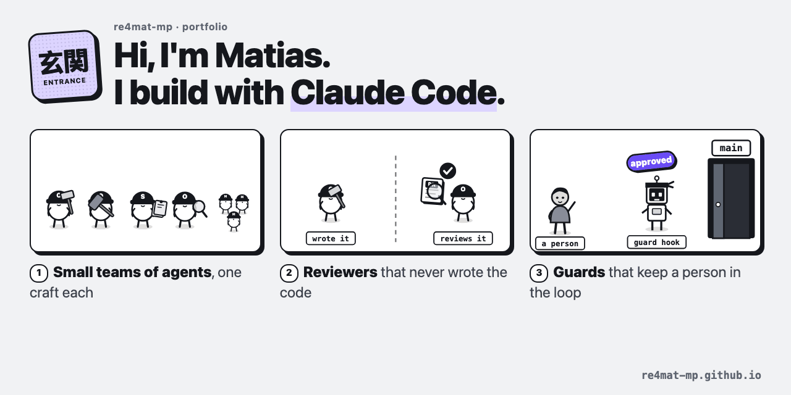

# re4mat-mp.github.io

The front door to my projects. **[Open it](https://re4mat-mp.github.io/)**.

I build with Claude Code: small teams of agents with one craft each, reviewers that never wrote the code they review,
and guards that keep a person in the loop before anything ships. Every piece opens: click a card, then its page.

**The pieces, in order**

1. **[The setup guide](https://re4mat-mp.github.io/claude-setup-guide/)** (箱, the box): my Claude Code setup and the
   habits behind it. [The repo](https://github.com/re4mat-mp/claude-setup-guide).
2. **[The factory](https://re4mat-mp.github.io/claude-setup-guide/factory/)** (工場): how I run the big jobs. A script
   cuts the work, agents read in parallel, code checks every answer.
3. **[The agent board](https://re4mat-mp.github.io/agent-dashboard/)** (匠, craft): a board to watch a crew of agents
   grow, rebuilt with an invented crew. [The repo](https://github.com/re4mat-mp/agent-dashboard).
4. **[The travel book](https://re4mat-mp.github.io/travel-book-method/)** (旅, a journey): a Kindle travel book written
   with Claude, the method shown on an invented trip. [The repo](https://github.com/re4mat-mp/travel-book-method).
5. **[The house](https://re4mat-mp.github.io/casa-3d/)** (家, a house): two floor plans turned into a 3D
   house you can walk through in the browser. [The repo](https://github.com/re4mat-mp/casa-3d).

Back to the profile: [github.com/re4mat-mp](https://github.com/re4mat-mp)

One HTML page and one script (`index.html`, `kit.js`): no frameworks, no web fonts, no outside requests. It reads
with JavaScript off too (the "Text version" at the bottom).
